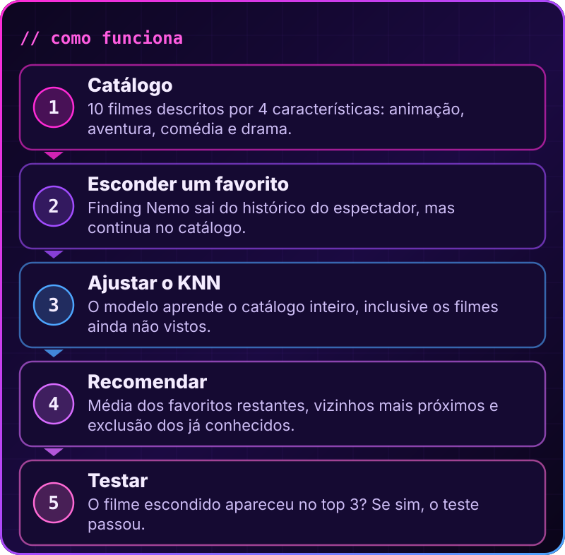

<p align="center">
  
</p>

<p align="center">
  
  
  
  
</p>

# 🎬 Recomendador de Filmes com KNN

Um sistema de recomendação **pequeno e didático**, feito para mostrar como o algoritmo **K-Nearest Neighbors (KNN)** pode sugerir filmes a partir dos favoritos de uma pessoa.

Em vez de apenas rodar o código, o projeto inclui um **teste de verdade**: um favorito é escondido do histórico e o modelo precisa "adivinhá-lo" entre as recomendações.

## 📚 Sumário

- [Ideia central](#-ideia-central)
- [Como funciona](#-como-funciona)
- [Os dados](#-os-dados)
- [A matemática por trás](#-a-matemática-por-trás)
- [Resultado](#-resultado)
- [Como executar](#-como-executar)
- [Usando como biblioteca](#-usando-como-biblioteca)
- [Estrutura do projeto](#-estrutura-do-projeto)
- [Limitações](#-limitações)
- [Próximos passos](#-próximos-passos)
- [Autor](#-autor)

## 💡 Ideia central

> Filmes parecidos ficam **perto** uns dos outros. Se você gostou de *Toy Story* e *Monsters, Inc.*, os melhores candidatos são os filmes que estão **mais próximos** do seu gosto médio.

Cada filme vira um vetor com 4 características (animação, aventura, comédia e drama). O gosto da pessoa é a **média** dos vetores dos filmes favoritos, e o KNN procura os vizinhos mais próximos desse ponto.

## 🧭 Como funciona

<p align="center">
  
</p>

1. **Catálogo:** 10 filmes, cada um descrito por 4 características.
2. **Esconder um favorito:** *Finding Nemo* sai do histórico do espectador, mas continua no catálogo.
3. **Ajustar o KNN:** o modelo (`NearestNeighbors`, métrica euclidiana) aprende o catálogo inteiro, inclusive os filmes ainda não vistos.
4. **Recomendar:** tira-se a média dos favoritos restantes, buscam-se os vizinhos mais próximos e excluem-se os filmes já conhecidos.
5. **Testar:** o filme escondido apareceu no top 3?

## 🗂️ Os dados

As características são valores **feitos à mão**, só para ensinar o conceito. Não são metadados oficiais dos filmes.

<p align="center">
  
</p>

| Filme | Animação | Aventura | Comédia | Drama |
| --- | :---: | :---: | :---: | :---: |
| Toy Story | 1 | 1 | 1 | 0 |
| Finding Nemo | 1 | 1 | 1 | 0 |
| Monsters, Inc. | 1 | 0 | 1 | 0 |
| The Incredibles | 1 | 1 | 0 | 0 |
| Shrek | 1 | 0 | 1 | 0 |
| Jurassic Park | 0 | 1 | 0 | 0 |
| Indiana Jones | 0 | 1 | 1 | 0 |
| The Hangover | 0 | 0 | 1 | 0 |
| The Shawshank Redemption | 0 | 0 | 0 | 1 |
| The Pursuit of Happyness | 0 | 0 | 0 | 1 |

## 📐 A matemática por trás

O **perfil** do espectador é a média dos vetores dos favoritos usados. Com *Toy Story* e *Monsters, Inc.*:

```text
perfil = ((1,1,1,0) + (1,0,1,0)) / 2 = (1,0 ; 0,5 ; 1,0 ; 0,0)
```

A proximidade entre o perfil `p` e um filme `f` é medida pela **distância euclidiana**:

$$d(p, f) = \sqrt{\sum_{i=1}^{4} (p_i - f_i)^2}$$

Exemplos:

- *Finding Nemo* `(1,1,1,0)`: `d = √(0² + 0,5² + 0² + 0²) = 0,50`
- *The Incredibles* `(1,1,0,0)`: `d = √(0² + 0,5² + 1² + 0²) ≈ 1,12`

**Menor distância = filme mais parecido com o gosto da pessoa.** Quando há empate, vale a posição do filme no catálogo, então a mesma execução sempre gera a mesma ordem.

## 🏆 Resultado

Saída do programa:

```text
Favoritos usados: Toy Story, Monsters, Inc.

Filmes recomendados:
1. Finding Nemo
2. Shrek
3. The Incredibles

Favorito escondido: Finding Nemo
Ele apareceu no nosso top 3? True

Este é apenas um teste pequeno com características feitas à mão, não é prova de qualidade no mundo real.
```

<p align="center">
  
</p>

## 🚀 Como executar

```bash
# 1. Clone o repositório
git clone https://github.com/GuilhermeGomesAI/movie-recommendation-knn.git
cd movie-recommendation-knn

# 2. (Opcional) crie um ambiente virtual
python -m venv .venv
source .venv/bin/activate        # Windows: .venv\Scripts\activate

# 3. Instale as dependências
pip install -r requirements.txt

# 4. Rode o projeto
python recomendador.py

# 5. Rode os testes automatizados
python -m unittest -v
```

## 🧩 Usando como biblioteca

```python
from recomendador import recomendar_filmes, ranking_de_filmes

recomendar_filmes(["Shrek", "The Incredibles"], quantidade=3)
# ['Toy Story', 'Finding Nemo', 'Monsters, Inc.']

ranking_de_filmes(["Shrek", "The Incredibles"])[:3]
# [('Toy Story', 0.707107), ('Finding Nemo', 0.707107), ('Monsters, Inc.', 0.707107)]
```

Se algum filme informado não existir no catálogo, a função lança um `ValueError`.

## 📁 Estrutura do projeto

```text
movie-recommendation-knn/
├── recomendador.py          # catálogo, modelo KNN e função de recomendação
├── requirements.txt         # numpy e scikit-learn
├── tests/
│   ├── __init__.py
│   └── test_recomendador.py # testes automatizados (unittest)
├── imagens/                 # ilustrações usadas neste README
│   ├── banner.svg
│   ├── pipeline.svg
│   ├── caracteristicas.svg
│   └── resultado.svg
├── LICENSE
└── README.md
```

## ⚠️ Limitações

- As características são **inventadas para ensinar**, com apenas 4 dimensões e valores 0 ou 1.
- O catálogo tem só **10 filmes**.
- O teste é **um único caso**: ele mostra que a ideia funciona, mas **não prova** qualidade em dados reais.
- Há vários empates de distância. Eles são resolvidos pela posição no catálogo, o que é determinístico, mas não é um critério "inteligente".

## 🔭 Próximos passos

- [ ] Usar um conjunto de dados real, como o MovieLens
- [ ] Testar a métrica de cosseno e comparar com a euclidiana
- [ ] Avaliar com várias rodadas, escondendo cada favorito por vez (*leave-one-out*)
- [ ] Medir qualidade com métricas como precisão@k e recall@k
- [ ] Criar uma pequena interface para escolher os filmes favoritos

## 👨‍💻 Autor

**Guilherme Gomes**, Security Analyst na Cielo e aspirante a AI Engineer.

[LinkedIn](https://www.linkedin.com/in/guilherme-gomes-ia/) · [GitHub](https://github.com/GuilhermeGomesAI)

## 📄 Licença

Distribuído sob a licença MIT. Veja o arquivo [LICENSE](LICENSE).
